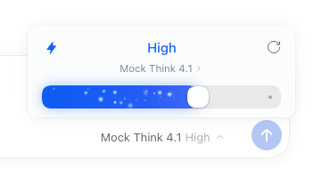
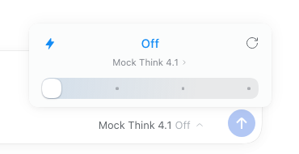

# dsh-effort-slider

[GitHub](https://github.com/kaivenw/dsh-effort-slider) · [Gitee](https://gitee.com/CodealienMan/dsh-effort-slider) · [MIT License](LICENSE)

把 DSH composer 里的「模型 / 推理强度」座位换成 Codex 风格的**可拖动强度条**：点开后是一张浮层，
标题是当前档位名，下面是当前模型（可点开切换），再下面是滑杆。

- 档位越高填充越长；普通档位是蓝色（档位越高色相越深），最高档是紫蓝渐变，**Off 不铺任何颜色**。
- 轨道上的小圆点标出当前档位之后的档位（按模型实际档位分布），拖过去就会被填充盖住。
- 填充段是像水一样向右流动的**点状星点**：每颗点的大小、速度、上浮与闪烁相位都不同（canvas 粒子，不会露出平铺贴图的固定图案）；整体流速随档位加快（Low → Max 约 1.3× → 2.8×），切档位时速度在 0.26s 内缓动，不会跳变。档位说明在滑杆的悬停提示里。
- 拖动时强度条跟着指针连续走、松手平滑吸附到最近档位；方向键也能切；右上角的 ↺ 重置为模型默认值。





## 它改了什么、没改什么

- 只遮住 composer 的模型座位（slot `conversation.input.model`，本插件以 priority -1 注册；single slot
  的规则是「同优先级冲突、最低优先级渲染」，官方 `ui-model-selection` 的座位在 0 被遮住）。
- 不替换官方包的其它能力：`/model` 命令弹窗、模型目录服务（`ctx.modelDirectories`）、
  `conversation.input.model.label` 标签扩展（1017 角标等）都继续由官方包提供。
- 档位、档位名与说明来自模型目录本身（宿主侧的推理元数据），本插件不硬编码模型清单；
  滑杆的悬停提示里显示档位说明（已知档位 off/low/high/max 使用中文说明，其它提供方用目录自带的 description）。

## 安装

前提：已装 DSH（桌面端或 `dsh web`），profile 目录在 `$DSH_HOME/profiles/<profile>`
（桌面端默认 `~/.dsh/profiles/desktop`）。macOS 没有 Node.js 也可以：直接用仓库根的 `install.command`，
它会借用 DSH 桌面端自带的运行时。

```bash
# 1) 克隆到一个不会被清理的目录（不要放 /tmp，装完 profile 会软链到这个目录）
git clone https://github.com/kaivenw/dsh-effort-slider.git
# 国内网络可用：git clone https://gitee.com/CodealienMan/dsh-effort-slider.git
cd dsh-effort-slider

# 2) 安装到默认 profile（桌面端 ~/.dsh/profiles/desktop；没有就找 web）
node scripts/install-profile.mjs
# 或显式指定：node scripts/install-profile.mjs --profile ~/.dsh/profiles/desktop
# 没有 Node.js 的 macOS 可以直接：./install.command
```

仓库里已带构建好的 `client.js`，安装不需要构建，也不需要装依赖。

脚本只做三件事（幂等，带备份）：
1. profile `package.json` 的 `dependencies` 加 `"@local/dsh-effort-slider": "link:<本仓>"`；
2. 同一份 `package.json` 的 `dsh.profile.bundles` 末尾追加 `@local/dsh-effort-slider`；
3. 在 `node_modules/@local/dsh-effort-slider` 建一条指向本仓的软链。

装完**重启 DSH**（桌面端退出重开；`dsh web` 重启进程）才会加载新的组合包。
卸载：`node <本仓>/scripts/install-profile.mjs --uninstall`，同样需要重启。

### 开发时热加载（可选）

如果 profile 的 `cordis.patch.yml` 已经挂了 `hmr` 且 root 指向本仓目录，改完 `client.js`
后已打开的页面会自动替换插件；没有 HMR 时刷新页面即可（不用重启 DSH）：

```yaml
- id: hmr
  disabled: false
  config:
    root:
      - '<本仓绝对路径>'
```

改 `src/client/**` 后先重新构建（构建需要 esbuild）：

```bash
pnpm install          # 或 npm install
pnpm run build        # 等价于 node scripts/build-client.mjs
```

## 打包分发

```bash
pnpm run package                  # 产物：dist/dsh-effort-slider-<version>.zip
```

zip 解压后是自包含目录（含 recipients 用的安装说明、`install.command`、预构建的 `client.js`）。
client.js 比 `src/client` 旧时脚本会直接失败——先跑 `node scripts/build-client.mjs`。

## 开发沙盒（不动真实 profile）

```bash
export DSH_HOME="$PWD/.dsh-dev"          # 任意 workspace 内目录
# 用桌面端内置的 CLI 起一个独立 web 实例（下面是 macOS 默认安装路径）
DSH_APP="/Applications/DeepSeek Harness.app/Contents/MacOS/DeepSeek Harness"
ELECTRON_RUN_AS_NODE=1 "$DSH_APP" \
  "/Applications/DeepSeek Harness.app/Contents/Resources/app.asar/dsh/node_modules/@deepseek-ai/dsh/lib/bin.js" \
  web --no-open --port 63150
```

> 上面的 asar 内路径以 0.2.1-rc.2 为例；换版本时用 `dsh --version` 对应的 CLI 即可，
> 或者直接用全局安装的 `dsh web`。

沙盒 profile 里用 pi-ai 的 `reasoningEfforts` 配一个假模型就能在没有账号的情况下调 UI，
不必依赖真实模型目录。

## 已知边界

- 本插件依赖官方 `@deepseek-ai/dsh-client-ui-model-selection` 提供的 `modelDirectories` 服务；
  停用官方包后本插件不会激活（composer 会没有模型座位）。
- 只换交互，不改请求：档位选择仍走 `session.selectModel`，从下一次请求生效，与官方选择器一致。
- 模型目录为空或当前模型没有推理元数据时，浮层只显示模型切换行，不显示滑杆。

## License

MIT，见 [LICENSE](LICENSE)。